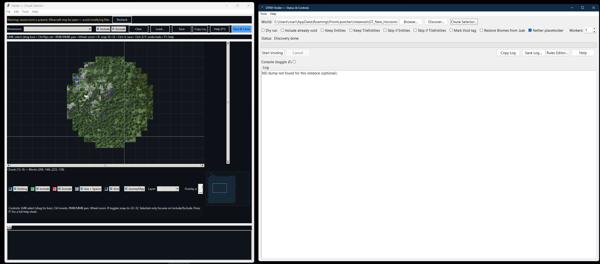

# GTNH World Voider (1.7.x)



A safe chunk-voiding tool with provider-safe biome handling, a visual chunk selector, and a rules editor. Works great for GT: New Horizons 1.7.x worlds.

---

## What it does

- **Provider-safe biome handling**
  - **Overworld:** keep `Level.Biomes[256]` if present; otherwise write Plains (id=1).
  - **Non-overworld:** keep `Level.Biomes` if present; otherwise **omit** the tag so the dimension provider recomputes on next load.
- **Chunk selection UI** (`chunkmap_ui.py`) for include/exclude by dimension (JM overlay, snap-to-32×32, undo/redo).
- **Rules Editor** with optional NEI “Dump ID Map” import.
- **Maintenance:** Tools → **Reset Biomes** (All / Non-Overworld) using the provider-safe policy.

---

## What’s included

- `Voider-GTNH.exe` — prebuilt one-file GUI for Windows.
- `main_voider.py` — core app (status window, voider, rules editor, provider-safe biome reset).
- `chunkmap_ui.py` — chunk selector UI.
- `build_voider.ps1` — PowerShell builder that makes both **onedir** (diagnostic) and **onefile** (final) EXEs, with logs.
- `requirements.txt` — minimal deps to run from source:
```

PyInstaller>=6.6
Pillow>=10.3
NBT==1.5.1

````
- `.gitignore`, `.readme` — project docs.

---

## How to run

### Option A — Run the EXE (easiest)

1. Download `Voider-GTNH.exe`.
2. Double-click it.  
 If you don’t pass a world path, it will auto-discover worlds and open the chunk selector.

> The EXE is built with PyInstaller and embeds Tkinter. Some AV tools flag one-file EXEs; if you’re unsure, run from source or build locally (below).

---

### Option B — Run from source (no binaries)

```powershell
# from the project folder:
python -m venv .venv
.\.venv\Scripts\pip install -r requirements.txt
.\.venv\Scripts\python .\main_voider.py
````

Tested with Python 3.10–3.13 on Windows (Tkinter required).

---

### Option C — Build your own EXE (local, reproducible)

```powershell
# from the project folder:
Set-ExecutionPolicy -Scope Process -ExecutionPolicy Bypass
.\build_voider.ps1
```

The script:

* creates `.venv`, installs deps,
* sanity-checks imports,
* builds **ONEDIR** (diagnostic) and **ONEFILE** (final),
* writes logs to `build-logs\`.
  Artifacts appear under `dist\`.

---

## Verifying / trust

If you want to verify the EXE you downloaded/built:

```powershell
certutil -hashfile .\dist\Voider-GTNH.exe SHA256
```

Compare the hash to your expected value (e.g., your local build vs. the release artifact).

---

## Notes & tips

* **Safety first:** the tool only edits `.mca` files inside the world you choose. Back up first. Try **Dry run** to preview changes.
* **JourneyMap overlay:** if a local JM cache exists, the selector can show day/topo/night/underground tiles; otherwise you still get the grid.
* **session.lock warning:** close Minecraft before writing; the UI will warn if `session.lock` is present.

---

## Troubleshooting

* **AV false positive:** build locally (`build_voider.ps1`) or run from source.
* **“tkinter not found” / blank window:** use the official python.org installer for Windows (includes Tk).
* **EXE opens but the map is empty:** make sure the selected folder is a real world (has `level.dat`) and the chosen dimension contains region files.

---

## Changelog (r11 highlights)

* Fixed biome saving/reading/cleaning system (provider-safe policy).
* Hardened region reader (handles odd gzip/zlib/raw cases and junk headers).
* Chunk selector: JM overlay, snap-to-32×32, undo/redo, selected-only view, per-dim UI state.
* Rules Editor with NEI dump import.
* Tools menu: Reset Biomes (All / Non-Overworld).

